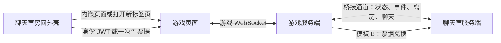

# ChatRoomGameDemo

聊天室插件房的游戏接入示例集合。项目通过可运行的游戏演示如何获取聊天室身份凭证、连接游戏服务、上报参与状态，以及同步离房和聊天事件，供开发者接入自己的游戏时复用。

**每个游戏示例子目录是一个独立项目**，拥有自己的启动入口、配置、依赖和说明文档。共享的 `nichijouSDK` 与游戏目录平级，作为独立 Go module 供所有示例引用；根目录统一维护项目介绍、接入教程与协议说明。

## 文档入口

- [接入教程](./接入教程.md)：从启动页面、创建插件房到完成联调，再将对接逻辑用于自己的项目。
- [协议说明](./协议说明.md)：身份凭证、桥接报文、外壳通信与版本管理。
- [Go SDK 使用](./接入教程.md#在自己的项目中复用-go-sdk)：共享模块引用与业务回调。
- [围棋 / 五子棋示例](./weiqiGame/README.md)：游戏简介与玩法。
- [你画我猜示例](./drawGuessGame/README.md)：游戏简介、玩法与配置。

## 示例项目

| 目录 | 内容 | 技术栈 | 接入方式 |
| --- | --- | --- | --- |
| [weiqiGame](./weiqiGame/) | 围棋 / 五子棋、双人对局、观战、头像与头像框、聊天、全屏控制 | Go 1.21+、原生 HTML / JavaScript | 内嵌 iframe、新标签页 |
| [drawGuessGame](./drawGuessGame/) | 你画我猜、多人轮流作画、聊天猜词、词库复用、原生画板 | Go 1.21+、原生 HTML / JavaScript（Canvas） | 内嵌 iframe、新标签页 |

```text
ChatRoomGameDemo/
├── README.md                  # 项目介绍与示例导航
├── 接入教程.md                 # 运行、部署与 SDK 使用
├── 协议说明.md                 # 通用协议与版本管理
├── nichijouSDK/               # 所有 Go 游戏共用的 SDK
│   ├── go.mod                 # 独立 module：ChatRoomGameDemo/nichijouSDK
│   └── README.md              # SDK 简介与文档导航
└── weiqiGame/                 # 独立的围棋 / 五子棋示例
    ├── README.md              # 游戏简介与玩法
    ├── shell/                 # Linux 构建、启动与停止脚本
    ├── go.mod                 # 该示例的 Go module
    ├── main.go                # 页面服务、游戏连接和业务回调
    ├── game.go                # 游戏规则
    ├── config.go              # 示例运行配置
    ├── config/                # 本地接入配置与验签公钥
    └── public/                # 游戏页面
└── drawGuessGame/             # 独立的你画我猜示例（结构同 weiqiGame）
    ├── README.md              # 游戏简介与玩法
    ├── shell/                 # Linux 构建、启动与停止脚本
    ├── go.mod                 # 该示例的 Go module
    ├── main.go                # 页面服务、游戏连接、桥接回调与猜词判定
    ├── game.go                # 回合制游戏规则（选题/绘画/计分/轮换）
    ├── words.go               # 词库加载与答题判定（复用旧画猜词库格式）
    ├── config.go              # 示例运行配置
    ├── config/                # 本地接入配置、验签公钥与词库
    └── public/                # 游戏页面（原生 Canvas 画板）
```

## 接入架构



聊天室提供房间入口、身份凭证、成员展示和聊天基础能力；游戏项目负责自己的规则、对局与游戏连接。游戏服务端验签后识别用户，并通过桥接通道向聊天室同步游戏状态。

通用服务端逻辑集中在根目录的 `nichijouSDK` 中，包括桥接握手与重连、JWT 验签、状态上报、身份挑战和票据兑换。各游戏通过 `require` 和本地 `replace` 引用同一份 SDK，修改 SDK 后所有示例在下次构建时使用更新后的代码；复用方式见[接入教程](./接入教程.md#在自己的项目中复用-go-sdk)。浏览器端与外壳的交互仍位于游戏页面中。

## 运行第一个示例

从本项目根目录执行：

```bash
cd weiqiGame
go run . -addr :8090
```

首次运行且尚未填写接入配置时，服务提供页面，游戏联机需要完成建房、配置凭证和加载公钥。按[接入教程](./接入教程.md)完成后，从聊天室的插件房进入游戏。

配置文件与静态页面路径相对于示例目录解析，请保持在 `weiqiGame` 内启动进程。

SDK 和游戏分别维护自己的 Go module，构建游戏时需要保留同级 `nichijouSDK` 目录。分别进入两个目录执行 `go vet ./...` 和 `go build ./...`；根目录不含 `go.mod`。

## 新增示例

在根目录下新增与 `weiqiGame` 平级的示例目录，并为其提供独立入口、配置说明和 README。游戏的 `go.mod` 引用 `ChatRoomGameDemo/nichijouSDK`，通过 `replace ChatRoomGameDemo/nichijouSDK => ../nichijouSDK` 使用共享源码，各游戏保留自己的业务实现；新增后将项目加入上面的示例表格。
